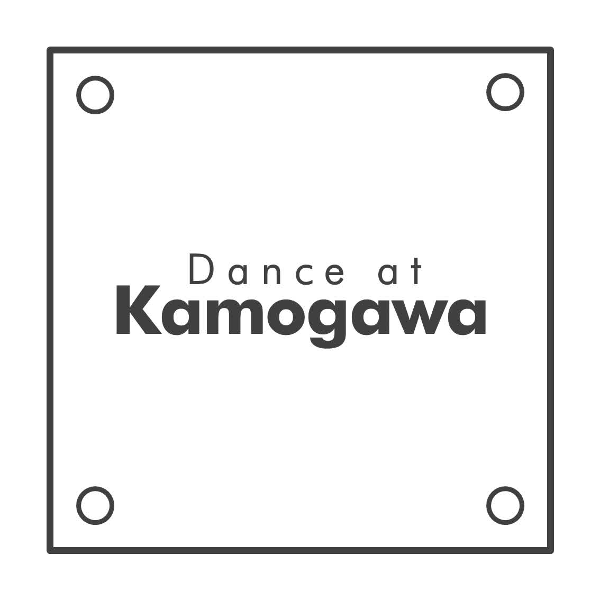

# Logo

## jpg


## png


## svg


### logotype


## Motion

`motion/` は [Remotion](https://www.remotion.dev/)（TypeScript + React）で作ったモーションロゴのプロジェクトです。
ロゴは `svg/dak_logo.svg` から 1000×1000 の座標系に平坦化して React コンポーネント化しており（`motion/scripts/extract-logo.ts`）、
枠（ブルーシート）・4つのペグ（ハトメ）・"Dance at" / "Kamogawa" の各グリフを個別にアニメーションできます。

コンセプト: **何もないところからイベントをはやす**。四角はブルーシート、四隅の輪は地面に打ち込んだハトメ。

### パターン

すべて 60fps、BPM グリッド（デフォルト 140 BPM、Studio で `bpm` を変えると尺も追従）で動きます。
各パターンは `-Square`（1080×1080）と `-Wide`（1920×1080）の2サイズ。

| パターン | 尺 (140 BPM) | 内容 |
| --- | --- | --- |
| **Genesis** | 22拍 / 約9.4秒 | 何もない画面に点がポンと生まれ → 細胞分裂して2つに → スピーカーになって拍に合わせて鳴り、音の輪を出す → 鴨川・高野川を下る紆余曲折の旅で出町の三角州（Y字）へ → もう一度分裂して四隅に飛び、ペグとして着地 → ブルーシートが広がって枠が描かれる → タイプライター風に "Dance at" "Kamogawa" が打たれる → ペグが拍で脈打つ |
| **Delta** | 13拍 / 約5.6秒 | 2本の川が上から描かれて Y 字に合流 → 合流点に点 → 波紋が広がり、最後の波紋が四角いシートになる → ペグが落ちてきて、文字がせり上がる |
| **TarpDrop** | 10拍 / 約4.3秒 | ブルーシートがひらひら落ちてきてバウンド着地 → 1拍に1本ずつペグを打ち込む → 文字がスタンプされる |
| **BeatLoop** | 4小節 / 約6.9秒 | VJ 用シームレスループ。ペグと枠が拍で脈動し、ペグから音の輪が出る。デフォルトは白・透過 |
| **Stinger** | 4拍 / 約1.7秒 | SNS 用の短いイントロ/アウトロ。`outro: false` で最後をロゴのまま止める |
| **Liquid** | 28拍 / 約12.0秒 | **水面と波紋**。夜の鴨川の水面を真上から見下ろす（WebGL）。ロゴ（枠・ハトメ・文字）は水の*底*に沈んでいて、静かな水面ではほとんど見えない。黒い水面がゆっくりうねり、遠くの街の灯りが横に流れる筋になって映る → 拍に合わせて雨粒が落ち（落下点に一瞬だけ光るグリント）、同心円の波紋が広がって干渉する。波紋が光を曲げ・集める（屈折とコースティクス）ところだけ、ロゴが断片的に、順番もなく見え隠れする。雨はだんだん密になり、裏拍のダブルでグルーヴを出す → 小節頭のダウンビートで4粒が4つのペグの位置に同時に落ち、波紋の中心がそのままハトメになる。細い枠を光が走る → 雨がやみ、水面が落ち着くにつれて川底の光がまだらに広がり、ロゴがはっきり読める状態で静止（ゆるいうねりと揺らめきは残る） |
| **LiquidLoop** | 4小節 / 約6.9秒 | Liquid の落ち着いた状態の VJ 用シームレスループ。拍ごとの雨（裏拍のダブル、4小節頭に4つのペグへの同時着水）が波紋を立て続け、水底のロゴを揺らめかせる |
| **DropLens** | 28拍 / 約12.0秒 | **雫レンズ**。黒い画面にガラスの雫が漂い、雫を通したところにだけロゴが拡大・反転して映る。雫は触れ合ってくっつき、また離れる → 4粒が四隅でビーズになってハトメに収まり、そこからロゴ全体が灯る。詳細: [`droplens/README.ja.md`](motion/src/compositions/droplens/README.ja.md) |
| **Condensation** | 28拍 / 約12.0秒 | **窓の結露**。雨の夜、曇った窓ガラス越しの街灯りのボケとロゴ。雫が育ち、拍で流れ落ちて曇りを拭い、その跡からロゴの断片が覗く → ダウンビートで4つのペグから曇りが晴れる。詳細: [`condensation/README.ja.md`](motion/src/compositions/condensation/README.ja.md) |
| **TarpRain** | 26拍 / 約11.2秒 | **シートの上の雨粒**。暗いブルーシートを真上から。雨粒が弾けて水玉になって転がり、ロゴの線に吸い込まれて「水で書かれたロゴ」になる。詳細: [`tarprain/README.ja.md`](motion/src/compositions/tarprain/README.ja.md) |
| **Caustics** | 28拍 / 約12.0秒 | **コースティクス投影**。宙に浮く水の塊が拍で揺れ、床に光の網目を落とす → 網目がだんだん整い、ダウンビートで光がロゴの形に集まる。詳細: [`caustics/README.ja.md`](motion/src/compositions/caustics/README.ja.md) |
| **DropLensLoop / CondensationLoop / TarpRainLoop / CausticsLoop** | 4小節 / 約6.9秒 | 上の4案それぞれの、落ち着いた状態の VJ 用シームレスループ（Wide のみ。MP4 と HAP Q） |

共通プロップ（Studio の右パネルで編集可）: `preset`（`ink` = #3f3f3f/白地, `white` = 白/透過, `tarp` = 白/ブルーシートの青 #1f5fb4）、
`color` / `background`（プリセットの上書き。`background` は `transparent` 可）、`bpm`、`logoScale`。

Liquid / LiquidLoop のプロップ: `bpm`、`liquidColor`（ハイライトの色味。コースティクス・グリント・屈折の色にじみ・波紋の稜線だけに出る。デフォルト #6fd3cd）、
`textColor`（文字とハトメ、#dedede）、`frameColor`（細い枠、#a6a6a6）、`background`（水の色。ほぼ黒のまま推奨、#000000）、`logoScale`（0.62）、
`rainDensity`（雨の量。1 = 標準、0 に近づけると任意の雨粒が間引かれ、2 で全部降る。ペグへの4粒は常に降る）。
LiquidLoop は加えて `offsetFrames`（ループの開始位置をずらす。継ぎ目の確認用）。

フライヤー（黒地にツヤのあるアクアのスプラッシュ）から借りたのは*質感*だけです: 黒、ツヤ、透明感、スペキュラ、アクアの差し色、細いグレーの枠、明るいグレーの文字。
説明的な段取り（集まる → はじける → ロゴ）は避け、黒い余白とゆっくりしたカメラのドリフトで、ロゴは「気づいたら読めている」ようにしています。

Liquid は three.js（`@remotion/three`）のフルスクリーンシェーダーで描いています。水面は高さ場で、川のゆるいうねり（数本の平面波）と、
雨粒ごとの減衰する同心円の波束（速いメインの輪＋遅く細かい表面張力波の輪＋着水点のくぼみ/跳ね返り）を足し合わせたものです。
高さ・勾配・ヘッセ行列を解析的に求め、勾配から屈折（色収差つき）で川底のロゴ（2D キャンバス）をずらし、ヘッセ行列から
コースティクス（光の集まり方 1/|det(I + D·H)|）で川底を照らします。反射は暗い夜空・横に流れる街灯りの筋・2つのランプのグリント。
波紋は 32px タイルごとに影響する雨粒だけを評価します（年齢とともに広がるリング状の範囲で判定）。
すべてフレーム番号から決まる決定的な計算です（乱数はシード付き）。LiquidLoop は波紋の年齢をループ長で折り返し、うねり・灯りの流れ・カメラも
ループ1周で整数周期になるので、最終フレームの次がフレーム 0 と完全に一致します。

### 使い方

```sh
cd motion
pnpm install
pnpm dev                 # Remotion Studio
pnpm typecheck
pnpm render --list       # レンダリング一覧
pnpm render              # すべて motion/out/ に書き出し
pnpm render --only=genesis,stinger   # ファイル名で絞り込み
pnpm stills Genesis-Square /tmp/stills 0,120,last   # 静止画チェック
pnpm extract             # SVG を更新したらジオメトリを再生成
```

Chrome Headless Shell をダウンロードできない環境では `REMOTION_BROWSER_EXECUTABLE=/path/to/chromium` を指定してください。
Liquid は WebGL を使います。デフォルトは `swangle`（ANGLE + SwiftShader のソフトウェア描画。GPU のない CI でも動く）で、
GPU のあるマシンでは `REMOTION_GL=angle` を指定すると速くなります（`remotion.config.ts` も同じ環境変数を見ます）。
目安: 4コアの GPU なし環境で Liquid 1080×1080 が約 0.29 秒/フレーム、1920×1080 が約 0.45 秒/フレーム、LiquidLoop（ProRes 中間）が約 0.53 秒/フレーム（`pnpm render` がジョブごとに ms/frame を表示します）。
HAP 変換には `ffmpeg`（hap エンコーダ付き）が必要です。

### 書き出しファイル（`motion/out/`）

- `dak-{genesis,delta,tarp-drop,beat-loop,stinger}-{1080x1080,1920x1080}-ink.mp4` — H.264
- `dak-genesis-1920x1080-white-alpha.mov` — ProRes 4444 + アルファ（`yuva444p10le`）
- `dak-beat-loop-1920x1080-white-alpha.mov` — ProRes 4444 + アルファ（シームレスループ）
- `dak-beat-loop-1920x1080-white-hap-alpha.mov` — HAP Alpha（Resolume 用）
- `dak-stinger-540x540-ink.gif` — GIF
- `dak-liquid-{1080x1080,1920x1080}.mp4` — Liquid、H.264
- `dak-liquid-loop-1920x1080.mp4` — LiquidLoop、H.264（シームレスループ）
- `dak-liquid-loop-1920x1080-hap.mov` — LiquidLoop、HAP Q（アルファなし。黒地なので Resolume ではスクリーン/加算合成で抜けます）

LiquidLoop は一度 ProRes 422 HQ（10bit）の中間ファイルに書き出し、そこから H.264 と HAP Q を作ります（H.264 からの再エンコードによる劣化を避けるため）。
中間ファイルは変換後に削除されます。

### リリース

タグを push すると GitHub Actions（`.github/workflows/motion-release.yml`）が全パターンをレンダリングし、GitHub Release に添付します。

```sh
git tag motion-v1.0.0 && git push origin motion-v1.0.0
```

Actions タブから手動実行（workflow_dispatch）した場合は、Release ではなくワークフローのアーティファクトとしてアップロードされます。

### ライセンスについて

Remotion は個人および従業員3人以下の団体なら無料で使えます。それ以上の規模の会社で使う場合は Company License が必要です（[remotion.dev/license](https://www.remotion.dev/license)）。
